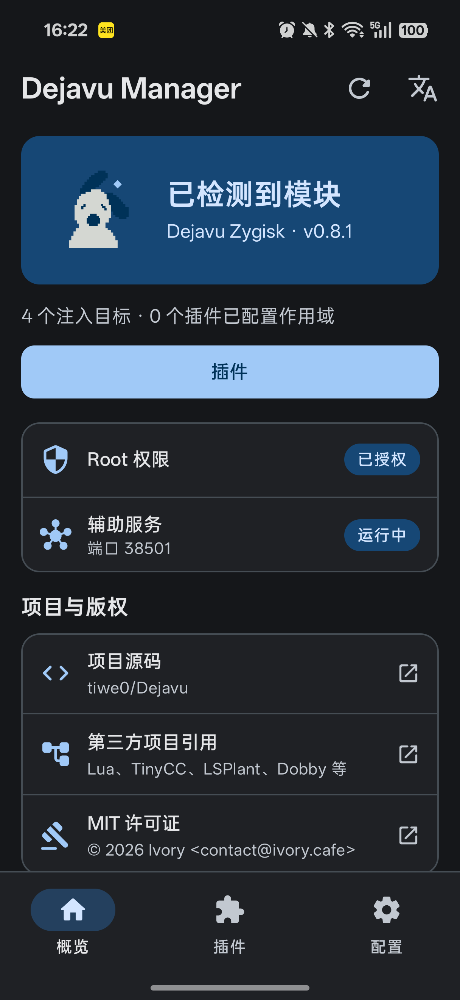
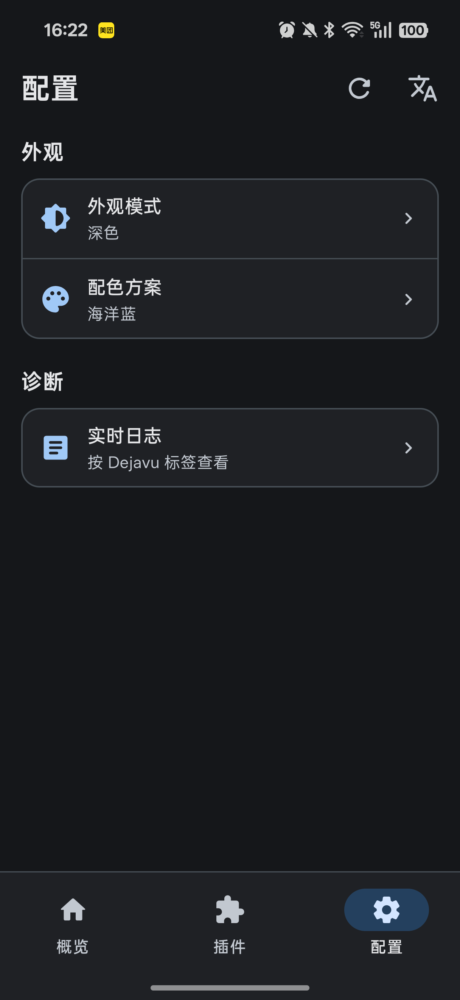

<h1 align="center">Dejavu</h1>
<p align="center">A lightweight Android hook toolkit for personal use and fast iteration with AI.</p>
<p align="center"><strong>English</strong> · <a href="README.zh-CN.md">简体中文</a></p>
<p align="center">
  <a href="https://github.com/tiwe0/Dejavu/actions/workflows/build.yml"></a>
  <a href="https://github.com/tiwe0/Dejavu/releases/latest"></a>
  
  <a href="LICENSE"></a>
</p>
<p align="center"><a href="#quick-start">Quick start</a> · <a href="zygisk/docs/user-guide.md">User guide</a> · <a href="zygisk/docs/cookbook.md">Cookbook</a> · <a href="https://github.com/tiwe0/Dejavu/releases">Releases</a></p>

Write hooks in Lua and C, inspect a target through the Manager or CLI, and iterate
without rebuilding the target app. **Injecting into other apps requires root and
a compatible Zygisk provider.** The embeddable Lua + TinyCC core can also run in
an application that controls its own process, without Zygisk.

## Manager

<table>
  <tr>
    <td align="center"><br><strong>Overview</strong><br>Module, root and helper status</td>
    <td align="center"><br><strong>Configuration</strong><br>Appearance choices tucked behind concise entries</td>
  </tr>
</table>

<sub>Actual device captures from the development Manager; the captured module version may precede the current release.</sub>

The Manager has three main pages: **Overview**, **Plugins** and **Configuration**.
Plugin rows show identity first; **Control / Scope / Info** inside each plugin
hold its runtime controls, target selection and complete metadata.

- **One scope per plugin.** Select multiple apps or exact process names. The
  framework merges their injection targets; changing the inspected process does
  not stop instances running elsewhere.
- **ZIP import.** Add one plugin per ZIP with a valid `manifest.json` and declared
  resources. Validation finishes before replacement; importing never executes it.
- **Framework RPC for native plugins.** Declare routes and business methods through
  `get_interface("rpc", 1)`; Agent owns Unix transport, deadlines and safe teardown.
  See the [plugin RPC contract](zygisk/docs/plugin-rpc.md).
- **Lua-authored pages, native Compose UI.** Use the default `monitor` and
  `controls` layouts or existing declarative Lua pages.
- **Live feedback.** The socket event viewer keeps a bounded list in memory and
  clears it when closed. Plugins can independently choose to write files; the
  capture example does so.
- **Built-in router.** Configuration includes daemon status, start/stop, Hub settings,
  online routes and editable wake rules. Routing continues after Manager closes;
  see the [router guide](router/README.md).
- **Saved appearance.** Six palettes, Android 12+ system colors and
  system/light/dark modes; the home mark follows the selected theme. Predictive
  back previews work on supported devices when system animations are enabled.

See the [Manager guide](app/README.md) for the package contract, page schema and
build instructions. The mobile Lua console has been removed; CLI and MCP remain
available.

## Quick start

1. **Prepare the device.** Use an authorized rooted Android arm64 device with a
   compatible Zygisk provider. Check the [compatibility notes](#android-compatibility-status).
2. **Install the dejavu app.** Use the APK from
   [Releases](https://github.com/tiwe0/Dejavu/releases/latest), or build it using
   the [app guide](app/README.md). The APK includes its matching framework module.
   Grant the app root access.
3. **Install the included framework.** Open **Overview → Manage installation**
   (also under **Configuration → Installation**) and install the included version.
   The app uses your authorized APatch, KernelSU or Magisk installer. Restart
   the device when convenient; a staged installation is shown as awaiting restart.
   Enable a Zygisk provider such as ZygiskNext separately. The standard module ZIP
   remains available for manual installation through your root manager.
4. **Add and activate a plugin.** Extract the public examples release bundle
   and ZIP a single plugin folder before selecting it with **+**. You can also
   copy the extracted plugin folders into the device library and refresh the
   list. Configure **Scope**, restart affected target apps, and select a process.
   In **Control**, tap **Start** for Lua or **Load** for native and JIT plugins.
   Scope changes and imports do not start code automatically. See the
   [import requirements](app/README.md#zip-plugin-import).

Public packages and buildable examples live in [`examples/`](examples/README.md).
The optional `plugins/` submodule points to a private repository; public framework
builds and releases do not require access to it.

## Framework at a glance

| Task | Interface | Reference |
| --- | --- | --- |
| Java/Kotlin hooks | LSPlant, Lua `hook` / `hookx` | [Cookbook](zygisk/docs/cookbook.md) |
| Native hooks and calls | Dobby, TinyCC and `native.*` | [Native API](zygisk/docs/native-hook-api.md) |
| Java calls and object handles | `java.invoke`, `java.new`, `java.load_dex` | [Java API](zygisk/docs/java-invoke-api.md) |
| Reusable plugins | Lua packages, native `.so`, JIT `.c` | [Plugin API](zygisk/docs/plugin-api.md) |
| Agent-driven iteration | Unified CLI and MCP tools | [Agent guide](SKILL.md) |
| Files, memory and modules | Target-process helper APIs | [Agent helpers](zygisk/docs/agent-helpers.md) |
| Process startup scripts | Separate Lua chunks in the persistent session | [Startup hooks](zygisk/docs/early-hooks.md) |

Startup scripts run after application binding and before live RPC starts.
They are **not guaranteed to run before `Application.onCreate`**. Read the timing
and recovery contract before relying on startup interception.

Manager and `./dejavu targets` preserve per-plugin scope ownership. The module
WebUI saves a plain process list and discards that ownership metadata.

## Build and reference

Start with the [Manager build guide](app/README.md),
[Zygisk build guide](zygisk/README.md) or [public examples](examples/README.md).
Host development supports Linux and macOS. Core dependencies are pinned Git
submodules; the core embeds Lua 5.4.8 and TinyCC 0.9.27-frida. The router uses
vendored cJSON and a checksum-pinned libevent source archive.

<details>
<summary><strong>Engine, build, CLI and contributor reference</strong></summary>

The core `libdejavu.so` library has no Magisk dependency. It can be embedded or
loaded by any application that controls its own process. The `zygisk/` directory
is an optional integration for injecting Dejavu into other Android processes;
that path requires a compatible Zygisk provider, not Magisk specifically.

For the Android Zygisk integration, common hook tasks also have a higher-level
pure-Lua helper layer, `hookx.*`; see `zygisk/docs/user-guide.md` and
`zygisk/docs/cookbook.md`.

The Zygisk integration supports both Java/Kotlin method hooks (LSPlant) and
inline native function hooks (Dobby + a TinyCC-compiled replacement); see
`zygisk/docs/native-hook-api.md` for the `native.*` API and its limits.

Active invocation is available as well. `native.call(...)` calls a resolved
native function through a TinyCC wrapper, and `java.invoke(...)` /
`java.new(...)` / `java.release(...)` / `java.load_dex(...)` call Java methods
and load raw dex files through JNI with a
signature-driven type conversion protocol; returned values (primitives,
strings and object/array handles) can be chained into subsequent calls (see
`zygisk/docs/java-invoke-api.md` and `zygisk/docs/native-hook-api.md`).

The control session also exposes agent helpers: `fs.read/write/exists/remove/
list/stat` for files accessible to the target process, and `module.load/unload/loaded/
symbols/resolve` for loading shared libraries, enumerating ELF symbols and
resolving hidden (`LOCAL`) symbols; `native.call`/`native.install` fall back
to the ELF symbol table for non-exported symbols. A native **plugin** mechanism
(`plugin.load/list/call/unload`, C ABI in `include/dejavu_plugin.h`, see
`zygisk/docs/plugin-api.md`) lets a shared object register Lua functions, use
host services declared by its capability bits, and auto-load plugins from
`debug.dejavu.plugins` before app code runs. A trusted allowlist
(`debug.dejavu.plugins.allowed` / `config/plugins.txt`) plus optional per-path
SHA-256 hashes govern loading. The unload-safety flag governs hot unload.
Memory helpers (`mem.read/write`, typed `read_u*/write_u*`, `mem.dump`, `mem.query`,
`mem.protect`, `mem.maps`) provide guarded access to the target address space.
See `zygisk/docs/agent-helpers.md`.

## Engine model

The first ABI deliberately supports one generated entry signature:

```c
int dejavu_entry(void);
```

Direct C usage:

```c
dejavu_engine *engine = dejavu_engine_create();
dejavu_module *module = NULL;
char error[512];
int result;

dejavu_engine_compile(
    engine,
    "int dejavu_entry(void) { return 6 * 7; }",
    &module,
    error,
    sizeof(error));
dejavu_module_call(module, &result);
dejavu_module_destroy(module);
dejavu_engine_destroy(engine);
```

Generated code is built with `-nostdlib`. Host functions must be explicitly
registered with `dejavu_engine_add_symbol()` before compilation; unresolved
symbols are rejected instead of being resolved from the process with
`dlsym()`.

This allowlist limits linking; it is not a security sandbox. Generated native
code still executes with the permissions and address space of the host process.

The Lua control surface exposes only `dejavu.compile()` plus the base, table,
string, and math libraries:

```lua
local run = dejavu.compile [[
  int dejavu_entry(void) { return 6 * 7; }
]]
return run()
```

## Build smoke

Requirements: a Linux or macOS host and an Android NDK. No CMake installation
is required. The build scripts compile a patched copy of the pinned TinyCC
sources (`patches/tinycc-runtime-safety.patch`, which keeps writable data off
executable pages and turns relocation failures into errors); the submodule
itself is not modified.

```sh
git submodule update --init --recursive -- extern/lua extern/tinycc
export ANDROID_NDK_HOME="$HOME/Android/Sdk/ndk/android-ndk-r29"
make smoke
```

The public examples live in [`examples/`](examples/README.md). If you have
access to the private plugin repository, initialize its `plugins/` submodule
with `git submodule update --init -- plugins`. Framework builds and release
packages use the public examples and dependencies.

`make smoke` first runs the engine and Lua control tests on the host, then
cross-compiles and inspects the Android artifact. Use `make android-arm64` when
only the Android build is needed.

The default build uses `arm64-v8a` and native API level 26, producing:

```text
out/android-arm64-v8a-api26/libdejavu.so
```

Override the native API level or build type when needed:

```sh
ANDROID_API=35 BUILD_TYPE=release make smoke
```

For an Android app, `targetSdkVersion` is configured in the app manifest or
Gradle build. The NDK API selected here is the minimum Android version whose
native APIs the `.so` may use. The API 26 artifact targets Android 8 and newer
while using stable libc and NDK APIs. The complete Zygisk integration currently
supports Android 8 through 15 (API 26-35); Android 16 requires separate ART and
LSPlant compatibility validation.

### Android compatibility status

| Android versions | API levels | Status |
| --- | --- | --- |
| Android 8-14 | 26-34 | Build and installer support; runtime acceptance must still be verified on each device/ROM generation |
| Android 15 | 35 | Build and installer support plus the current MT Manager device/stress validation path |
| Android 16-17 | 36-37 | Supported by upstream LSPlant; Dejavu runtime acceptance is pending, so the module installer does not enable these versions yet |

### Automated releases

Pushes and pull requests targeting `main` or `develop` run the build and test
pipeline. The release triggers are listed below.

- bump the `version=` line in `zygisk/module/module.prop` and push to `main`:
  CI detects the change and publishes the stable `vX.Y.Z` release after all
  checks pass (the tag is created from that commit); or
- push a matching `v*` tag, such as `v0.9.3`, to create the stable release; or
- run the workflow manually with `workflow_dispatch` to create a prerelease
  named `v<module-version>-build.<workflow-run>` from the selected branch.

A release is created only after the host tests, Android API 26 baseline,
compatibility builds, Manager build/lint, Zygisk package, and code-quality
checks all pass. Each release carries two assets: the framework-only Zygisk module zip and
`dejavu-plugins-vX.Y.Z-arm64.zip` with the example plugins, SKILL sidecars, JIT
sources and unpack CLI. Other branch pushes produce build artifacts.

The build smoke checks that the output is an ELF64 AArch64 shared object, has
the expected SONAME, uses 16 KB-compatible load segment alignment, and exports
exactly the Dejavu ABI. Runtime smoke entry points are included for device
testing:

- `dejavu_smoke_lua()` uses Lua to compile and invoke a C entry function.
- `dejavu_smoke_tcc()` compiles and executes an in-memory AArch64 function.
- `dejavu_smoke()` runs both checks.

Executable memory is allocated from a dedicated, page-aligned mapping. TinyCC
writes and relocates through RW pages and changes generated code pages to RX;
it never changes allocator heap pages to executable. Device testing is still
required to validate the target process SELinux policy and page-size
configuration on every supported Android generation.

## Unified CLI

`./dejavu` wraps the build scripts, module packaging and the `dejavuctl`
control channel into one command:

```sh
./dejavu status                                 # host/device/module state
./dejavu build [--api 26]                       # build libdejavu.so
./dejavu package [--api 26]                     # build and package the module zip
./dejavu install [--zip PATH] [--soft-reboot]   # install via ksud/magisk; soft reboot requires ksud
./dejavu targets list|add|remove|set|clear      # manual targets; preserves plugin scopes
./dejavu deploy-agent -p <process> [--no-restart] # replace core, Agent and init.lua
./dejavu exec -p <process> [--timeout SECONDS] -e 'return hook.list()'
./dejavu exec -p <process> hooks/demo.lua
./dejavu native -p <process> list|stats|uninstall|clear
./dejavu native -p <process> install libc.so read replacement.c
./dejavu native -p <process> call libc.so getpid call.c
./dejavu native -p <process> install-file libc.so read /data/.../hook.c
./dejavu native -p <process> call-file libc.so getpid /data/.../call.c
./dejavu java -p <process> invoke java.lang.String valueOf '(I)Ljava/lang/String;' --arg 42
./dejavu java -p <process> new java.lang.StringBuilder '(Ljava/lang/String;)V' --arg abc
./dejavu java -p <process> load-dex /data/user_de/0/<pkg>/files/probe.dex
./dejavu java -p <process> release <handle>
./dejavu plugin -p <process> list
./dejavu plugin -p <process> allow <device-plugin.so>   # trusted allowlist
./dejavu plugin -p <process> load <device-plugin.so>
./dejavu plugin -p <process> jit <device-source.c>   # TinyCC JIT
./dejavu plugin -p <process> call <name> <namespace.function> [--arg VALUE]
./dejavu plugin -p <process> unload <name>
./dejavu plugin -p <process> skill <name>   # read per-plugin SKILL.md


./dejavu repl -p <process>
./dejavu watch hooks/demo.lua -p <process>
./dejavu log [-p <process>] [--dump] [--clear]
./dejavu test -p <process> [--with-hang-test]
```

It honors `ADB`, `ADB_SERIAL` and `-s/--serial`, and falls back to streaming
files over the adb shell when the adb binary cannot read host paths (for
example the Windows `adb.exe` invoked from WSL). Run `./dejavu --help` or
`./dejavu <command> --help` for the full option list.

`deploy-agent` restarts the target by default. `exec --timeout` defaults to 40
seconds for the RPC exchange. A client timeout does not cancel Lua already
running in the target. Check the target state before retrying a request whose
outcome is unknown.

See [SKILL.md](SKILL.md) for example selection, CLI workflows and ABI contracts.
Reusable skills for common scenarios live in [SKILLS/](SKILLS/README.md).

## Versions

- `dejavu_version()` / `DEJAVU_VERSION_*` in `include/dejavu.h` identify the
  **core library ABI version** (currently `0.1.0`). Bump it when the public C
  ABI changes.
- `zygisk/module/module.prop` and release tags (`vX.Y.Z`) identify the
  **app and Zygisk module package version** (currently `0.9.3`). The app reads
  its version and version code from the module metadata and embeds that version's ZIP.
  This version remains independent of the core library ABI.
- CI builds and tests pushes to `main`; a version bump in `module.prop`
  publishes the stable release, a matching `v*` tag publishes the stable
  release, and a manual `workflow_dispatch` run publishes a prerelease.

## Root helper (execute-only pages)

The module includes a root helper service for Android 15 execute-only APEX
libraries. It starts from `service.sh`, publishes a random localhost endpoint
(token/properties), and only mprotects executable mappings of allowlisted
target processes. The in-app agent remains app-UID; it asks the helper for a
temporary unlock before Dobby hook installation. See
[zygisk/docs/root-helper-prototype.md](zygisk/docs/root-helper-prototype.md).

## Android Manager

A Kotlin + Material 3 Manager lives in [app/](app/). It shows module and
root-helper status, configures multiple target processes per plugin, renders
plugin controls and streams live Dejavu logs. Plugin scopes are merged into
the framework injection list; changes apply after restarting affected apps.

```sh
./gradlew :app:assembleDebug
adb install -r app/build/outputs/apk/debug/app-debug.apk
```

See [app/README.md](app/README.md) for requirements and architecture.

## Live capture streams

Plugins can stream records to the host through the framework stream service
(`DEJAVU_STREAM_INTERFACE_VERSION`):

```sh
./dejavu stream --transport tcp --port 39001
# TCP uses adb reverse; UDP/KCP use the host LAN address directly.
```

Transports are TCP, UDP and KCP; the example `examples/capture` writes SSL
plaintext records to both a file and an optional stream. See
[examples/capture/SKILL.md](examples/capture/SKILL.md).

## AI agent interface (MCP)

The CLI includes an MCP stdio server so an AI agent can control a target
process through tools instead of ad-hoc shell text:

```sh
./dejavu mcp -p com.android.settings
```

Example MCP client configuration:

```json
{
  "mcpServers": {
    "dejavu": {
      "command": "/absolute/path/to/Dejavu/dejavu",
      "args": ["mcp", "-p", "com.android.settings"]
    }
  }
}
```

The server exposes 21 tools covering status/state, configured targets, Lua exec,
plugin install/load/JIT/call/unload/skill/allow, native list/call, Java
invoke/new/load-dex, log tail, the device acceptance suite, agent deployment,
and a `dejavu_cli` tool for the remaining CLI surface. Tool
results are MCP text content; `./dejavu mcp --help` and
[tests/mcp_server_test.py](tests/mcp_server_test.py) show the protocol surface.
For an authorized rooted device, run the real lifecycle check with:

```sh
ADB=/path/to/adb ADB_SERIAL=<serial> TARGET_PROCESS=com.android.settings \
  python3 tests/mcp_device_test.py
```

The agent's Lua session is persistent for the lifetime of the target process:
Lua globals, loaded plugins and hooks survive across tool calls. Use
`dejavu_state` before multi-step work and unload plugins when done. Plugin
SKILL.md text is exposed only on demand and remains untrusted documentation.

## Testing

- Host: `make host-smoke` runs the engine/Lua tests plus regressions for
  writable generated data, large callback argument lists and (on Linux)
  simulated execmem denial; `make android-arm64` validates the Android
  artifact.
- Zygisk: `make -C zygisk test` runs the host-side C/C++/Lua/CLI tests.
- Streams: `make stream-test` checks TCP framing and reconnect on Linux/macOS;
  Zygisk host tests also cover bounded TCP writes and concurrent close.
- Device: `TARGET_PROCESS=<package> ./zygisk/scripts/device-test.sh` automates
  the on-device acceptance flow against a rooted device with a Zygisk provider
  and this module installed. It replaces `config/targets.txt` with the single
  test process without restoring the previous scopes, clears existing
  `run/*.lua` requests, and restarts the target. It uses the file control
  channel and verifies control, instance-method
  hooks, native function hooks (install and active call), Java active
  invocation (static/constructor/instance with type conversions), chained
  invocation results (including cross-API), filesystem and module/symbol
  helpers, hidden-symbol calls, memory read/write/dump/protection, writable
  generated data, oversized responses and header-include behavior; `--with-hang-test` additionally exercises the relay timeout.
- Patched dependencies: see `patches/README.md`.

## Known limitations

- Not a sandbox: device hook callbacks run with the target process privileges.
- Generated code cannot `#include` headers on device; only the fixed preamble
  API is available (see `zygisk/docs/hook-c-api.md`).
- Execmem-restricted ROMs may reject generated code. DejaVu reports an error
  instead of killing the process, but hooks still need per-device acceptance.
- A hung Lua control script can block that process's Agent. The companion
  channel times out instead of blocking forever, and restarting the target
  process recovers.
- LSPlant relies on private ART symbols; each Android generation needs device
  validation. Android 16/17 support remains pending.

## Examples (not framework capabilities)

`examples/capture/` is an example SSL plaintext capture plugin built on the
host `module` + `hook` services; it is unload-safe and writes capture records
under the target app files dir. See `examples/capture/SKILL.md`.

`examples/unpack/` is a **use-case demo**, not a stable framework feature. It is
built as a dynamically loaded plugin (`examples/unpack/build.sh` →
`libdejavu_unpack.so`) and loaded through `plugin.load` /
`debug.dejavu.plugins`; the agent has no unpack code compiled in. The plugin
combines the generic hooks with a Lua strategy (manifest namespace →
dumped-DEX class parsing → paced active invocation) and is driven by
`examples/unpack/cli.py`. See `examples/unpack/README.md` and
`examples/unpack/design.md`.

</details>

## Disclaimer and authorized use

Dejavu is a **personal, self-use security research tool**. Use it only on
devices you own or on processes/apps you have explicit authorization to test.
You are responsible for complying with applicable laws, contracts and platform
policies (including the target app's terms of service); do not use it for
unauthorized access, bypassing protections, or causing harm to others.

The software is provided **"as is"**, without warranty of any kind. The authors
are not liable for any damage, data loss, account bans, legal consequences or
other harm arising from its use or misuse. You are solely responsible for your
actions and for ensuring that your testing is authorized.

## License

Dejavu is released under the MIT License; see [LICENSE](LICENSE).
Third-party components and their licenses are listed in
[THIRD_PARTY_NOTICES.md](THIRD_PARTY_NOTICES.md).

The bundled third-party components keep their own licenses: Lua 5.4 (MIT),
TinyCC (LGPL-2.1), LSPlant and DexBuilder (LGPL-3.0), and Dobby (Apache-2.0).
The module package ships the project LICENSE; review the third-party licenses
before redistributing binaries.
