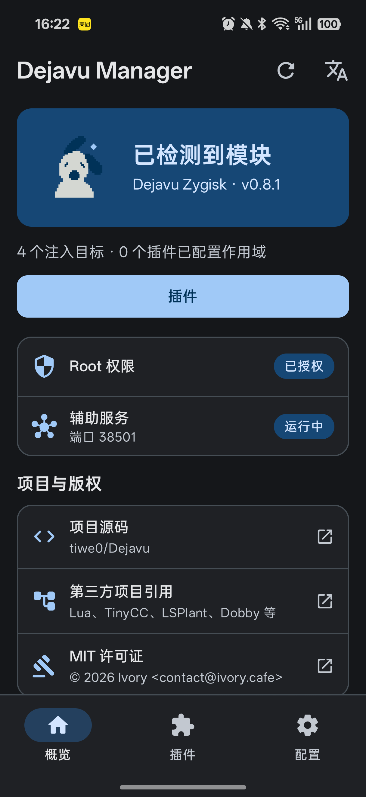
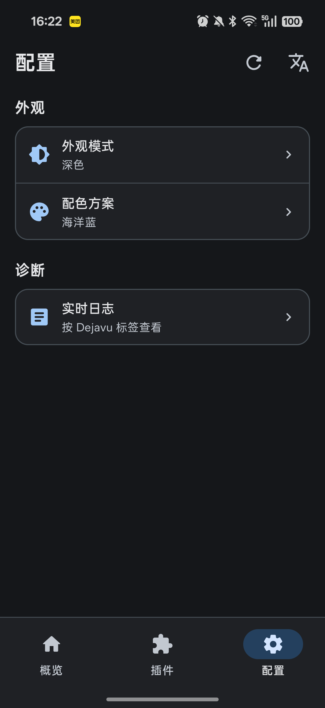

<h1 align="center">Dejavu</h1>
<p align="center">个人自用、适应 AI 时代敏捷开发的轻量级 Android Hook 工具。</p>
<p align="center"><a href="README.md">English</a> · <strong>简体中文</strong></p>
<p align="center">
  <a href="https://github.com/tiwe0/Dejavu/actions/workflows/build.yml"></a>
  <a href="https://github.com/tiwe0/Dejavu/releases/latest"></a>
  
  <a href="LICENSE"></a>
</p>
<p align="center"><a href="#快速上手">快速上手</a> · <a href="zygisk/docs/user-guide.md">使用指南</a> · <a href="zygisk/docs/cookbook.md">Hook 示例</a> · <a href="https://github.com/tiwe0/Dejavu/releases">版本下载</a></p>

用 Lua 和 C 编写 Hook，通过 Manager 或 CLI 查看目标状态，直接迭代，无需重新
构建目标应用。**向其他应用注入需要 root 和兼容的 Zygisk provider。**
Lua + TinyCC 核心也可以嵌入能够控制自身进程的应用，这种用法不依赖 Zygisk。

## Manager

<table>
  <tr>
    <td align="center"><br><strong>概览</strong><br>模块、root 与辅助服务状态</td>
    <td align="center"><br><strong>配置</strong><br>简洁入口，按需展开外观选项</td>
  </tr>
</table>

<sub>以上为开发版 Manager 的实机截图，截图中的模块版本可能早于当前发布版本。</sub>

Manager 分为**概览、插件、配置**三个主页面。外部插件列表只保留身份信息，
每个插件内部的**控制／作用域／信息**分别承载运行操作、目标选择和完整元数据。

- **每个插件独立配置作用域。** 支持多选应用与精确进程名，框架合并各插件的
  注入目标；切换查看进程不会停止其他进程中已运行的插件实例。
- **ZIP 导入。** 每个 ZIP 只包含一个插件，需提供合法的 `manifest.json` 及声明资源。完整校验后
  才替换现有版本，导入本身不执行代码。
- **框架统一 RPC。** 原生插件通过 `get_interface("rpc", 1)` 声明路由和业务方法，
  Agent 负责 Unix 通信、超时取消及卸载保护，详见[对接规范](zygisk/docs/plugin-rpc.md)。
- **Lua 编写页面，Compose 原生渲染。** 支持默认 `monitor`、`controls` 布局，
  并兼容已有声明式 Lua 页面。
- **实时反馈。** socket 事件查看器只在内存中保留有界列表，关闭后清空。
  插件自身仍可选择写文件，例如公开的 capture 示例。
- **内置路由服务。** 配置页提供 daemon 状态、启停、Hub 配置、在线路由与唤醒规则管理。
  关闭 Manager 后仍继续转发，详见 [Router 指南](router/README.md)。
- **外观自动保存。** 提供六套配色、Android 12+ 系统取色，以及跟随系统／浅色／
  深色模式；首页狗头随主题变化。支持设备且开启系统动画时可显示预测式返回预览。

包结构、页面 schema 和构建方式见 [Manager 指南](app/README.md)。手机端 Lua
Console 已移除，CLI 和 MCP 接口继续保留。

## 快速上手

1. **准备设备。** 使用本人控制或已获授权的 Android arm64 root 设备，并安装
   兼容的 Zygisk provider。先查看[兼容性说明](#android-兼容性状态)。
2. **安装框架。** 从 [Releases](https://github.com/tiwe0/Dejavu/releases/latest)
   下载模块 ZIP，在 root 管理器中安装并重启设备。具体步骤见
   [安装指南](zygisk/docs/user-guide.md)。
3. **打开 Manager。** 按 [App 指南](app/README.md)构建，或从成功的
   [Build Dejavu 工作流](https://github.com/tiwe0/Dejavu/actions/workflows/build.yml)
   下载 `dejavu-manager-debug` 产物。CI APK 使用调试签名，与正式模块 ZIP 分开提供。
   为 Manager 授予 root 权限。
4. **添加并启用插件。** 先解压公开示例发布包，再把单个插件目录打成 ZIP，
   点击右下角 **+** 选择该 ZIP。也可以把解出的插件目录复制到设备插件库后刷新。
   在插件内配置**作用域**，重启受影响的应用，再选择进程并在**控制**页操作。
   Lua 插件用**启动**，Native/JIT 插件用**加载**。修改作用域或导入文件
   都不会自动执行插件代码。见 [导入要求](app/README.md#zip-plugin-import)。

公开插件和可构建示例位于 [`examples/`](examples/README.md)。可选的 `plugins/`
子模块指向私有仓库，公开框架构建与发布不要求访问它。

## 框架能力

| 任务 | 接口 | 文档 |
| --- | --- | --- |
| Java/Kotlin Hook | LSPlant、Lua `hook` / `hookx` | [常用 Hook 示例](zygisk/docs/cookbook.md) |
| Native Hook 与主动调用 | Dobby、TinyCC、`native.*` | [Native API](zygisk/docs/native-hook-api.md) |
| Java 调用与对象句柄 | `java.invoke`、`java.new`、`java.load_dex` | [Java API](zygisk/docs/java-invoke-api.md) |
| 可复用插件 | Lua 包、原生 `.so`、JIT `.c` | [插件 API](zygisk/docs/plugin-api.md) |
| AI agent 迭代 | 统一 CLI、MCP 工具 | [Agent 指南](SKILL.md) |
| 文件、内存与模块 | 目标进程内的 helper API | [Agent helpers](zygisk/docs/agent-helpers.md) |
| 按进程加载启动脚本 | 持久会话中的独立 Lua chunk | [启动 Hook](zygisk/docs/early-hooks.md) |

启动脚本在应用绑定之后、实时 RPC 启动之前执行，**不保证早于
`Application.onCreate`**。依赖启动时机前，请先阅读执行与错误恢复约定。

Manager 和 `./dejavu targets` 会保留逐插件的作用域归属。模块 WebUI 保存的是
普通进程列表，会丢弃归属元数据。

## 构建与参考

按需求查看 [Manager 构建指南](app/README.md)、[Zygisk 构建指南](zygisk/README.md)
或[公开示例](examples/README.md)。主机开发支持 Linux 和 macOS。公开依赖以固定
Git 子模块引入，核心内嵌 Lua 5.4.8 和 TinyCC 0.9.27-frida。Router 使用随仓库提供的
cJSON，以及校验 SHA-256 的固定版本 libevent 源码包。

<details>
<summary><strong>展开引擎、构建、CLI 与贡献者参考</strong></summary>

核心 `libdejavu.so` 不依赖 Magisk。任何能够控制自身进程的应用都可以直接
集成或加载它。`zygisk/` 目录只是一个可选集成，用于把 Dejavu 注入其他
Android 进程；这条路径需要兼容的 Zygisk provider，但并不特指 Magisk。

Android Zygisk 集成还提供了纯 Lua 的高级辅助层 `hookx.*`，用于完成常见
hook 操作。完整说明参见 `zygisk/docs/user-guide.md` 和
`zygisk/docs/cookbook.md`。

Zygisk 集成同时支持 Java/Kotlin 方法 hook（LSPlant）和已加载模块中的
native 函数 inline hook（Dobby + TinyCC 生成的替换函数）；`native.*`
API 与限制见 `zygisk/docs/native-hook-api.md`。

主动调用时，`native.call(...)` 通过 TinyCC 包装器调用已加载模块中解析到的
原生函数。`java.invoke(...)` / `java.new(...)` / `java.release(...)` /
`java.load_dex(...)` 通过 JNI
直接调用 Java 方法，参数由 JNI 签名驱动转换；返回值（primitive、string、
对象/数组 handle）可以继续参与后续调用（见 `zygisk/docs/java-invoke-api.md`
和 `zygisk/docs/native-hook-api.md`）。

控制会话还提供 agent helper：`fs.read/write/exists/remove/list/stat` 用于
目标进程可访问路径的文件读写；`module.load/unload/loaded/symbols/resolve` 用于
加载 so、枚举 ELF 符号和解析隐藏（`LOCAL`）符号；`native.call` /
`native.install` 在导出符号查找失败时会回退 ELF 符号表。原生 **plugin** 机制
（`plugin.load/list/call/unload`，C ABI 见 `include/dejavu_plugin.h`，文档见
`zygisk/docs/plugin-api.md`）允许插件动态注册 Lua 函数，并可通过
`debug.dejavu.plugins` 在 App 代码执行前自动加载；allowlist 支持可选的
per-path SHA-256 校验。内存 helper
（`mem.read/write`、类型化 `read_u*/write_u*`、`mem.dump`、`mem.query`、
`mem.protect`、`mem.maps`）提供带映射校验的目标地址空间访问。详见
`zygisk/docs/agent-helpers.md`。

## 引擎模型

第一版 ABI 有意只支持一种生成代码入口签名：

```c
int dejavu_entry(void);
```

直接通过 C API 使用：

```c
dejavu_engine *engine = dejavu_engine_create();
dejavu_module *module = NULL;
char error[512];
int result;

dejavu_engine_compile(
    engine,
    "int dejavu_entry(void) { return 6 * 7; }",
    &module,
    error,
    sizeof(error));
dejavu_module_call(module, &result);
dejavu_module_destroy(module);
dejavu_engine_destroy(engine);
```

生成代码使用 `-nostdlib` 编译。所有宿主函数必须先通过
`dejavu_engine_add_symbol()` 显式注册；未解析符号会被拒绝，而不会通过
`dlsym()` 自动从宿主进程解析。

这份允许列表限制的是链接范围，并不是安全沙箱。生成的 native 代码仍然
拥有宿主进程的权限，并运行在同一地址空间中。

Lua 控制层只开放 `dejavu.compile()`，以及 base、table、string 和 math
标准库：

```lua
local run = dejavu.compile [[
  int dejavu_entry(void) { return 6 * 7; }
]]
return run()
```

## 构建与冒烟验证

构建环境需要 Linux 或 macOS 主机以及 Android NDK；核心库不要求安装
CMake。构建脚本会在临时副本上为固定的 TinyCC 源码应用
`patches/tinycc-runtime-safety.patch`（将可写数据与可执行页分离，并让
重定位失败返回错误而不是退出进程），不会改动 submodule 本身。

```sh
git submodule update --init --recursive -- extern/lua extern/tinycc
export ANDROID_NDK_HOME="$HOME/Android/Sdk/ndk/android-ndk-r29"
make smoke
```

公开示例位于 [`examples/`](examples/README.md)。有私有插件仓库权限时，可用
`git submodule update --init -- plugins` 初始化插件子模块。框架构建和发布包使用
公开示例与依赖。

`make smoke` 会先执行引擎和 Lua 控制层的主机测试，然后交叉编译并检查
Android 产物。若只需要 Android 库，可执行 `make android-arm64`。

默认目标为 `arm64-v8a`、native API 26，输出路径为：

```text
out/android-arm64-v8a-api26/libdejavu.so
```

可以覆盖 native API 或构建类型：

```sh
ANDROID_API=35 BUILD_TYPE=release make smoke
```

Android 应用的 `targetSdkVersion` 由应用清单或 Gradle 配置；这里选择的
NDK API 表示 `.so` 允许使用的最低 Android native API。API 26 产物面向
Android 8 及以上版本，并只使用稳定的 libc 和 NDK API。

完整 Zygisk 集成当前支持 Android 8 至 15（API 26-35）。Android 16 涉及
ART 私有接口和 LSPlant 兼容性，必须作为独立适配目标验证，不能仅凭核心
库成功构建就视为已经支持。

### Android 兼容性状态

| Android 版本 | API | 状态 |
| --- | --- | --- |
| Android 8-14 | 26-34 | 已支持构建和安装；仍需在各代设备及 ROM 上完成运行验收 |
| Android 15 | 35 | 已支持构建和安装，并具备当前 MT Manager 真机及压力测试路径 |
| Android 16-17 | 36-37 | 上游 LSPlant 已支持；Dejavu 尚待真机运行验收，因此模块安装器暂未放开 |

### 自动发布

向 `main` 或 `develop` 推送、以它们为目标发起 Pull Request，都会执行构建与测试。
正式发布和预发布的触发条件如下。

- 修改 `zygisk/module/module.prop` 的 `version=` 并推送到 `main`：CI 检测到
  版本变化后，在所有检查通过时从该提交创建稳定版 `vX.Y.Z` 并发布（自动创建
  标签）；
- 推送与模块版本一致的 `v*` 标签（例如 `v0.9.0`）时创建正式版本；
- 手动运行 `workflow_dispatch` 时，从所选分支创建
  `v<模块版本>-build.<工作流运行号>` 预发布版本。

只有主机测试、Android API 26 基线、兼容性构建、Manager 编译与 lint、Zygisk
打包和代码质量检查全部通过后才会发布。每个 Release 带两个资产：framework-only 的 Zygisk 模块
zip，以及包含示例插件 `.so`、SKILL、JIT 源码和 unpack CLI 的
`dejavu-plugins-vX.Y.Z-arm64.zip`。其他分支推送生成构建 artifact。

构建冒烟检查会验证产物满足以下条件：

- ELF64 AArch64 共享库；
- SONAME 正确；
- LOAD 段满足 16 KB 页面对齐；
- 仅导出预期的 Dejavu ABI。

库中还包含用于真机验证的入口：

- `dejavu_smoke_lua()`：通过 Lua 编译并调用一个 C 入口函数；
- `dejavu_smoke_tcc()`：编译并执行一个内存中的 AArch64 函数；
- `dejavu_smoke()`：依次运行以上两项检查。

可执行内存来自独立且按页对齐的映射。TinyCC 在 RW 页面中写入和重定位，
随后只把生成代码所在页面切换为 RX；它不会把分配器堆页面改成可执行。
每个受支持的 Android 代际仍需要真机验证目标进程的 SELinux 策略和页面
大小配置。

## 统一 CLI

`./dejavu` 把构建脚本、模块打包和 `dejavuctl` 控制通道收进一个命令：

```sh
./dejavu status                                 # 主机/设备/模块状态
./dejavu build [--api 26]                       # 构建 libdejavu.so
./dejavu package [--api 26]                     # 构建并打包模块 zip
./dejavu install [--zip PATH] [--soft-reboot]   # 通过 ksud/magisk 安装，软重启需要 ksud
./dejavu targets list|add|remove|set|clear      # 编辑手动目标，保留插件作用域
./dejavu deploy-agent -p <进程> [--no-restart]    # 替换核心库、Agent 和 init.lua
./dejavu exec -p <进程> [--timeout SECONDS] -e 'return hook.list()'
./dejavu exec -p <进程> hooks/demo.lua
./dejavu native -p <进程> list|stats|uninstall|clear
./dejavu native -p <进程> install libc.so read replacement.c
./dejavu native -p <进程> call libc.so getpid call.c
./dejavu native -p <进程> install-file libc.so read /data/.../hook.c
./dejavu native -p <进程> call-file libc.so getpid /data/.../call.c
./dejavu java -p <进程> invoke java.lang.String valueOf '(I)Ljava/lang/String;' --arg 42
./dejavu java -p <进程> new java.lang.StringBuilder '(Ljava/lang/String;)V' --arg abc
./dejavu java -p <进程> release <handle>
./dejavu plugin -p <进程> list
./dejavu plugin -p <进程> allow <设备plugin.so>   # 信任 allowlist
./dejavu plugin -p <进程> load <设备plugin.so>
./dejavu plugin -p <进程> jit <设备source.c>   # TinyCC JIT
./dejavu plugin -p <进程> call <name> <namespace.function> [--arg 值]
./dejavu plugin -p <进程> unload <name>
./dejavu plugin -p <进程> skill <name>   # 读取插件 SKILL.md


./dejavu repl -p <进程>
./dejavu watch hooks/demo.lua -p <进程>
./dejavu log [-p <进程>] [--dump] [--clear]
./dejavu test -p <进程> [--with-hang-test]
```

支持 `ADB`、`ADB_SERIAL` 与 `-s/--serial`；当 adb 二进制无法读取主机路径
（例如从 WSL 调用 Windows 的 `adb.exe`）时会自动改用 adb shell 流式传输
文件。`./dejavu --help` 或 `./dejavu <命令> --help` 查看完整选项。

`deploy-agent` 默认重启目标进程。`exec --timeout` 是 RPC 交换期限，默认 40 秒。
客户端超时不会取消目标内已开始执行的 Lua。遇到执行结果未知的请求，先检查目标状态再决定是否重试。

示例选型、CLI 操作流程和 ABI 约定见 [SKILL.md](SKILL.md)。
常见场景的专项技能位于 [SKILLS/](SKILLS/README.md)。

## 版本语义

- `include/dejavu.h` 中的 `dejavu_version()` / `DEJAVU_VERSION_*` 是**核心库
  ABI 版本**（当前 `0.1.0`），公共 C ABI 变化时才递增。
- `zygisk/module/module.prop` 和 release tag（`vX.Y.Z`）是 **Zygisk 模块包
  版本**（当前 `0.9.0`）；模块打包、loader/agent 行为与文档更新独立递增。
- CI 对 `main` 的 push 会构建测试；`module.prop` 版本变化会发布正式版本，
  匹配的 `v*` tag 发布正式版本，手动 `workflow_dispatch` 发布预发布版本。

## 实时抓包流

插件的框架 stream 服务支持 TCP/UDP/KCP：

```sh
./dejavu stream --transport tcp --port 39001
# TCP 自动 adb reverse；UDP/KCP 使用本机 LAN 地址直连。
```

示例 `examples/capture` 可同时写文件和可选的实时 stream；用法见
[examples/capture/SKILL.md](examples/capture/SKILL.md)。

## AI agent 接入（MCP）

CLI 内置 MCP stdio server，AI agent 可以通过工具调用控制目标进程，而不是
拼 ADB shell 文本：

```sh
./dejavu mcp -p com.android.settings
```

MCP 客户端配置示例：

```json
{
  "mcpServers": {
    "dejavu": {
      "command": "/absolute/path/to/Dejavu/dejavu",
      "args": ["mcp", "-p", "com.android.settings"]
    }
  }
}
```

当前提供 21 个工具：status/state、目标列表、Lua exec、插件
install/load/JIT/call/unload/skill/allow、native list/call、Java
invoke/new/load-dex、日志 tail、设备验收套件、agent 部署，以及 `dejavu_cli` 通用逃生口。工具结果通过 MCP text content 返回；
协议面见 [tests/mcp_server_test.py](tests/mcp_server_test.py)。已 root 的真机可跑：

```sh
ADB=/path/to/adb ADB_SERIAL=<serial> TARGET_PROCESS=com.android.settings \
  python3 tests/mcp_device_test.py
```

目标进程存活期间 Lua 会话是持久的：Lua 全局变量、已加载插件和 hook 会跨
工具调用保留。多步操作前先调 `dejavu_state`，结束后及时 unload 插件。
插件 SKILL.md 仅在按需读取时返回，仍按不可信文档处理。

## 测试

- 主机：`make host-smoke` 覆盖引擎/Lua 测试，以及可写数据、大参数回调、
  （Linux 上）模拟 execmem 拒绝等回归；`make android-arm64` 校验 Android 产物。
- Zygisk：`make -C zygisk test` 运行主机侧 C/C++/Lua/CLI 测试。
- 真机：`TARGET_PROCESS=<包名> ./zygisk/scripts/device-test.sh` 在已 root、
  装有 Zygisk provider 且已安装模块的设备上自动验收（见 `zygisk/README.md`）。
  脚本会把 `config/targets.txt` 覆盖为单一测试进程，结束时不会恢复原作用域。
  它会清除现有的 `run/*.lua` 请求并重启目标进程。验收走文件控制通道，覆盖控制面、实例方法 hook、可写
  生成数据、超大响应与头文件 include 行为；`--with-hang-test` 额外验证
  relay 超时。
- 依赖补丁：见 `patches/README.md`。

## 已知限制

- 不是安全沙箱：hook 回调以目标进程权限运行。
- 设备端生成的代码不能 `#include` 头文件，只能使用固定 preamble 里的 API
  （见 `zygisk/docs/hook-c-api.md`）。
- 加固 ROM 可能拒绝 execmem；DejaVu 会返回错误而不是杀死进程，但 hook 仍需
  按设备验收。
- 挂死的 Lua 控制脚本会卡住该进程的 Agent；companion 通道会超时而不是永久
  阻塞，重启目标进程可恢复。
- LSPlant 依赖私有 ART 符号，每个 Android 代际都需要真机验证；Android
  16/17 仍待验收。

## 示例（非框架能力）

`examples/unpack/` 是**用例示范**，不是框架稳定能力。它被编译为动态加载插件
（`examples/unpack/build.sh` → `libdejavu_unpack.so`），通过 `plugin.load` /
`debug.dejavu.plugins` 加载；agent 里不再编译任何 unpack 代码。插件把通用 hook
与 Lua 策略（Manifest 命名空间 → dumped DEX 类解析 → 节流主动调用）组合起来，
由 `examples/unpack/cli.py` 驱动。详见 `examples/unpack/README.md` 与
`examples/unpack/design.md`。

</details>

## 免责声明与授权使用

Dejavu 是一个**自用的安全研究工具**。请仅在您拥有的设备、或您已获得明确
授权的进程/应用上进行测试。您需自行遵守适用法律、合同与平台政策（包括
目标应用的服务条款）；不得用于未授权访问、绕过保护措施或损害他人。

本软件按**“现状”**提供，不附带任何形式的保证。作者不对使用或误用造成的
任何损害、数据丢失、账号封禁、法律后果或其他损失负责。您对自己的行为以及
测试的授权合规性负全部责任。

## 许可证

Dejavu 以 MIT 许可证发布，详见 [LICENSE](LICENSE)。第三方组件及其
许可证见 [THIRD_PARTY_NOTICES.md](THIRD_PARTY_NOTICES.md)。

内置的第三方组件保留各自许可证：Lua 5.4（MIT）、TinyCC（LGPL-2.1）、
LSPlant 与 DexBuilder（LGPL-3.0）、Dobby（Apache-2.0）。模块包会附带
本项目的 LICENSE；再分发二进制前请自行核对第三方许可证要求。
