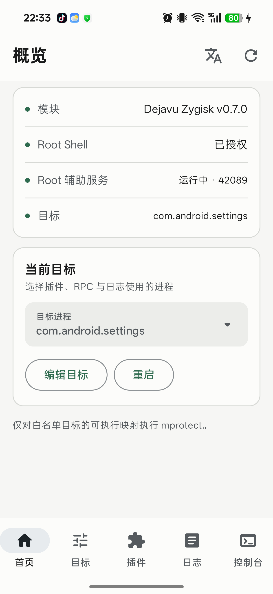
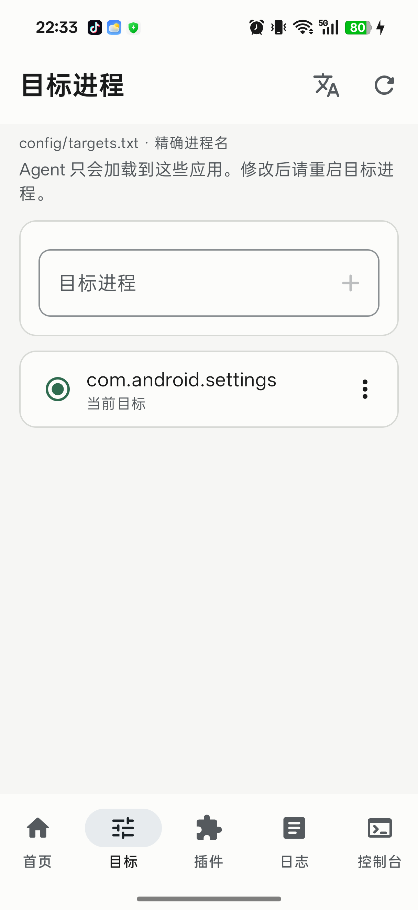
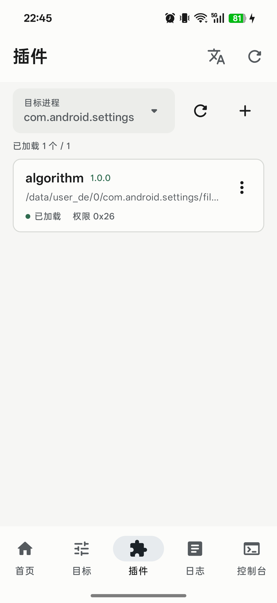
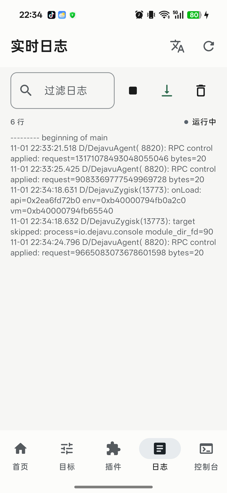
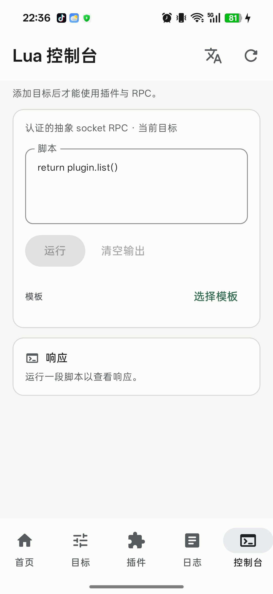
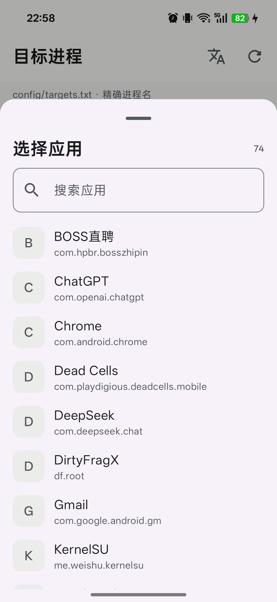
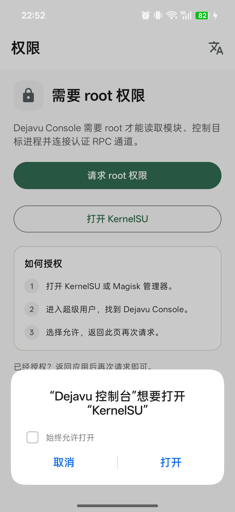

# Dejavu Console (Android)

Package: `cafe.ivory.dejavu` · version: `0.2.2`

Kotlin + Jetpack Compose Material 3 control app for Dejavu.

## Build

Requirements:

- JDK 21 (Android Studio JBR works)
- Android SDK platform 36 + build-tools 36.0.0
- `local.properties` with `sdk.dir=...`

```sh
./gradlew :app:assembleDebug
adb install -r app/build/outputs/apk/debug/app-debug.apk
```

AGP 9.2.1 uses built-in Kotlin; there is no separate Kotlin Android plugin.

For a project-local toolchain installed under `out/tooling`, use:

```sh
source out/tooling/env.sh
./gradlew :app:assembleDebug :app:lintDebug -PdejavuSideBySide=true --max-workers=2
```

The optional `dejavuSideBySide` profile builds **Dejavu Dev** as
`cafe.ivory.dejavu.debug`, signed with
`out/tooling/android-user/debug.keystore`. This keeps an installed release and
its data available while testing. Keep this signing file for later Dev updates;
the profile uses the standard Android debug signing credentials.

## What it does

- **Overview** – module version, root shell, root helper endpoint, selected target.
- **Targets** – edit `config/targets.txt`, restart target processes.
- **Plugins** – reads `plugin.list()` through Dejavu's authenticated Lua RPC,
  imports Lua plugin folders, scans `/data/adb/dejavu/plugins`, starts/stops
  directory plugins and shows live events. Native plugins retain SKILL.md,
  unload and `.so`/JIT `.c` load-by-device-path.
- **Live logs** – streams `DejavuZygisk`, `DejavuAgent`, `DejavuPlugin`,
  `DejavuHook`, `DejavuNative`.
- **Lua console** – executes Lua on the selected target via the same control
  channel used by `dejavuctl`.

### Data path

```text
app UID
  ├─ su -M -c: module.prop, targets.txt, root-helper properties
  └─ abstract Unix socket + 32-byte token:
       /data/adb/modules/dejavu_zygisk/run/<process>.<pid>.rpc
       → in-app agent Lua runtime
```

The app itself is not root. It invokes `su -M -c` for root-only reads/writes and
talks to the agent through its authenticated local socket.

## i18n

- Default: English (`values/strings.xml`)
- Simplified Chinese: `values-zh-rCN/strings.xml`
- Android 13+ per-app locale via `res/xml/locales_config.xml`
- In-app language picker in the top bar (Android 13+)

## Notes

The host regressions do not require an Android device. With JDK and the Kotlin
compiler on PATH, prepare the small host-only `org.json` jar and run:

```sh
mkdir -p out/tooling
curl -fL https://repo.maven.apache.org/maven2/org/json/json/20250517/json-20250517.jar \
  -o out/tooling/json-20250517.jar
make -C zygisk test
bash app/tests/run-host.sh
bash app/tests/importer/run-host.sh
bash app/tests/native/run-host.sh
```

`KOTLINC`, `JAVA_HOME` and `JSON_JAR` can select local tools. Android itself
already provides `org.json`; no application dependency was added. Checks cover
RPC endpoint selection, target changes, root commands, package validation and
Lua lifecycle ownership, a self-contained sample package and live-event frame decoding.

- Debug APK uses a development key; release signing is configured separately.
- The console requires the v0.7.0+ module with the RPC-enabled agent.
- Native `.so`/JIT `.c` folders can be imported and loaded from the app. Loading
  stages a target-readable copy and pins its SHA256 in the trusted allowlist.

## Directory plugin import

The default library is `/data/adb/dejavu/plugins/<plugin-id>`. The app reads it
through `su`; it is independent of the installed module's versioned directory.
Tap **Import folder**, select a folder containing `manifest.json`, then
select a target and tap **Start**. Importing copies code only and never starts it.
Tap **Scan** to discover folders copied into the default library outside the app.
Only immediate subfolders with `manifest.json` are plugins. Bare files, folders
without manifests and the older `dejavu-plugin.json` name are ignored. The
manifest identifier must match its installed folder name.

The generic Lua fixture in `app/tests/fixtures/example-plugin` demonstrates the
package lifecycle and declared resource access. **Live events** keeps at most
50 events in memory;
closing the sheet, leaving the tab or changing target clears them. No message
files or history database are created.

Native and JIT packages use the same metadata fields with `kind: "native"` and
a `.so` entry, or `kind: "jit"` and a `.c` entry. Their declared binary/source
resources are copied without executing them. The local list shows manifest
name, version and description, plus the selected target's runtime state. Tap
**Load** to deploy and run one plugin; native/JIT package imports are limited to
32 resources, 32 MiB per library, 512 KiB per JIT entry and 64 MiB in total.
SKILL sidecars must also be declared. Other trusted-plugin entries are preserved.

Each directory package uses this version-1 contract:

```json
{
  "schemaVersion": 1,
  "id": "example",
  "name": "Example",
  "version": "1.0.0",
  "kind": "lua",
  "entry": "app.lua",
  "files": ["app.lua", "hook.c"]
}
```

The entry returns `start(ctx)`, `stop(ctx)` and `status(ctx)` functions.
`ctx.session` identifies the activation and `ctx.read(path)` returns declared
UTF-8 resources. Optional `events` declares `tag`, `marker` and
`format: "urlencoded-json-v1"`. Its optional `titleField`, `contentField`,
`metaField`, `dedupFields`, `dedupFallbackFields` and `dedupIgnoreValues` configure
the generic event viewer; Manager contains no target-app-specific event logic.
Packages are limited to 32 resources / 256 KiB, and RPC scripts to 1 MiB.
Malformed packages are reported without hiding valid packages. Replacing a
running or unknown-state import is blocked; check its status and stop it first.

Imported files use root-only 700/600 permissions. Import stages and validates a
complete package before replacing it; rename failures restore the old directory.
A power loss between the two renames can leave a hidden `.backup-*` directory
for manual recovery. Lua resources use the Lua package lifecycle; native
libraries continue to use the native plugin ABI and unload rules.


## Screens

| | |
|---|---|
|  |  |
|  |  |



## App picker

Target selection is done by clicking the target process row and choosing an
installed app from a searchable bottom sheet. The old free-form process field
is gone; each row shows the real launcher icon and package name, and the list is reloaded every time the picker opens so newly installed apps appear immediately; the selected package is added to `config/targets.txt` and becomes the
active target.



## Interaction notes

- Selected target is persisted in SharedPreferences and reused after restart.
- Destructive operations (remove target, unload plugin) ask for confirmation.
- Plugin list refreshes when the Plugins tab opens or the selected target changes.
- Live logs pause auto-scroll when the toggle is off; the filter is local-only.
- The header progress bar reflects root-shell/RPC work in progress.
- `./gradlew` wrapper is pinned to Gradle 9.4.1; use JDK 21 and Android SDK 36.


## Release build

A signed release build is configured but the keystore is intentionally not
committed.

```sh
cp app/keystore.properties.example app/keystore.properties
# create a local keystore:
keytool -genkeypair -v -keystore out/tooling/dejavu-console.jks \
  -alias dejavu-console -keyalg RSA -keysize 2048 -validity 10000 \
  -storepass change-me -keypass change-me \
  -dname "CN=Dejavu Console, O=Dejavu, C=CN"
# edit app/keystore.properties to match
./gradlew :app:assembleRelease
adb install -r app/build/outputs/apk/release/app-release.apk
```

Release uses R8 + resource shrinking. `versionName` is `0.2.2` (`versionCode` 4).
The app is self-signed; for distribution replace the local keystore with a
stable release key.


## Root permission screen

Until KernelSU/Magisk authorizes the app, the console replaces the dashboard
with a dedicated permission screen. It requests root, offers a direct shortcut
to KernelSU, and shows the authorization steps. The bottom navigation and
normal dashboard are hidden in this state.


